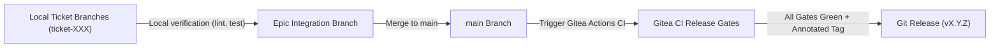

# AGENTS.md — Zappa TV Development & Operating Instructions

This document is the authoritative guide for AI agents and developers working on the **Zappa TV (`zappatv`)** repository (hosted at `https://git.halvmj.uk/dany/zappatv.git`).

**Current delivery policy:** CI and releases deliver unsigned versioned WGTs/checksums for Apps2Samsung automatic signing, preserve application identity/data, and do not require local/CI certificates. Prioritize Tizen 5.0+; 3.0/4.0 are experimental. The app is named **Zappa TV** and is baseline version **1.0** (`1.0.0`). The owner's Tizen 5 QE55Q70RATXXC has a working baseline: retained playlists/settings, live picture/sound and remote navigation confirmed. Retain all implemented features and both VOD layouts. Production playback is TV-only; browser UI/test simulation remains.

**Zappa TV** is a next-generation Samsung Tizen Smart TV IPTV & VOD client built for **IPTV Manager** (`http://localhost:8000` / `https://iptv.example.com`). Its architecture comprises:
1. **Modern TV UI & Visual Experience**:
   - **Unified Aqua Translucent Theme**: Deep navy frosted-glass surfaces (`--surface-1`, `--over-video`), glowing focus indicators, and high-contrast typography.
   - **Start Page & Hero Hub (`StartPage.tsx`)**: High-level launch cards for Live TV, Movies, Series, and Settings with resume context, recently watched items, and screensaver integration.
   - **Adaptive Channel Tile Grid (`HomeTileGrid.tsx`)**: 4–6 column channel grid with live EPG progress bars, channel number badges, centered logos, and parallelogram category ribbon.
   - **Translucent Channel & 7-Day EPG Schedule Panel (`ChannelEpgPanel.tsx`)**: Side-by-side categories, channels, and programme schedule overlay with `▶ replay` catch-up badges.
   - **Dual VOD Browsing Hub (`VodView.tsx`, `SeriesView.tsx`)**: Poster Grid and Fast List layouts with dedicated 6-column grid, season/episode navigation, metadata cards, and fast alphabet jump.
2. **Robust Hardware Playback Engine & AVPlay Integration**:
   - **Samsung AVPlay Engine**: Low-latency 1000ms live zapping buffer (`PLAYER_BUFFER_FOR_PLAY = 1s`) tuned for IPTV Manager's Rust MPEG-TS proxy (`Port 8001`), paired with 5000ms VOD buffers.
   - **Hardware Track Switching**: Multi-audio (`AUDIO`) and native DVB/Teletext/CEA subtitle (`TEXT`) track enumeration and switching via `webapis.avplay`.
   - **Tuning & Watchdog (`useTuner`)**: 450ms channel zap settle debounce, 12s stall/freeze watchdog, and automatic backoff reconnect (`4s / 8s / 15s`).
   - **VOD Playback Controls & Autoplay**: Progressive directional seek preview (`10s`->`30s`->`1m`->`5m`->`10m`), calibrated "Up Next" autoplay countdown (starts `setting + 1s` before episode end with 1s safety buffer), and smart Previous restart logic.
   - **Aspect-Ratio Scaling**: Automatic 4:3 SD detection (`NARROW_ASPECT = 1.6` in `Player`) with configurable zoom/fit options.
3. **Two-Tier Storage & Idle Persistence**:
   - Synchronous `localStorage` (`services/store.ts`) for instant boot and preferences.
   - 24 MB Live TV IndexedDB (`services/disk.ts`) for channels, logos, and EPG.
   - Dedicated 200 MB persistent VOD IndexedDB (`services/vodStore.ts`, database `zappa-vod`) for movie and series catalog metadata, isolated from Live TV.
   - Zero IndexedDB work on interaction path via `services/idle.ts` (`requestIdleCallback` fallback) to maintain 60fps D-pad navigation.
4. **Network & WebAssembly Services**:
   - Dual authentication: standard Xtream Codes (`/player_api.php`) and streamlined single-token IPTV Manager login (`x-zappa-token`), plus `/api/epg/batch` for single-request tile grid EPG population.
   - `services/repair.ts` exclusively owns `manifest-socket.wasm` (loopback HLS 32-bit `MEDIA-SEQUENCE` repair).
   - `services/remoteServer.ts` exclusively owns `management-socket.wasm` (LAN HTTP server for phone QR setup and `SmartRemote`).

---

## 1. System Context & Hybrid Architecture

```
  ┌─────────────────────────────────────────────────────────────────────────┐
  │                     Samsung Tizen Smart TV (2020+)                      │
  │                                                                         │
  │   Zappa TV Web Application (.wgt / React 19 + TypeScript + Zustand 5)   │
  │   • 5-Layer Screen Stack & Generalized Remote Key Laws                  │
  │   • Zappa TV UI: Home Tile Grid + Translucent Channel/EPG + Dual VOD    │
  │   • useTuner: 450ms Zap Settle, 12s Stall Watchdog, 4s/8s/15s Retry     │
  │   • AVPlay Hardware Engine: 1s Live Buffer, Audio/Subtitle Track Picker │
  │   • Two-Tier Storage: Sync localStorage + 24MB Live DB + 200MB VOD DB   │
  │   • WASM Sockets: Loopback Manifest Repair + LAN Phone QR SmartRemote   │
  └───────────────────┬─────────────────────────────────┬───────────────────┘
                      │                                 │
        HTTP / JSON   │  /player_api.php & /api/*       │  HTTP / MPEG-TS (/live/*)
                      ▼                                 ▼
  ┌───────────────────────────────────┐ ┌───────────────────────────────────┐
  │   IPTV Manager Flask API (:8000)  │ │   IPTV Manager Rust Proxy (:8001) │
  │                                   │ │                                   │
  │ • Xtream API (/player_api.php)    │ │ • 1-to-Many Stream Multiplexing   │
  │ • Per-Client Rules & Adult Filter │ │ • Circular MPEG-TS Ring Buffer    │
  │ • Batch EPG (/api/epg/batch)      │ │ • Slot-Aware Connection Quotas    │
  │ • Zappa Token Auth (x-zappa-token)│ │ • Multi-Provider Failover         │
  └───────────────────────────────────┘ └───────────────────────────────────┘
```

---

## 2. Core Engineering Invariants

Break any of these invariants and the application will regress on real Samsung TV hardware:

1. **The screen is a strict stack and a layer only shows when nothing above it is open**:
   - `App.tsx` defines the layer stack:
     - Layer 1: Hardware `AVPlay` surface. Browser UI preview uses the development simulation; production widgets never add HTML-video/HLS fallbacks.
     - Layer 1.1: Picture state card (connecting, slow link, paused, failed — non-blocking so navigation always works).
     - Layer 2: Transient two-row Playback Banner & OSD (identity, progress, audio/subtitle track selectors).
     - Layer 3: Channel & EPG Overlay Panel (translucent side-by-side categories, channels, and programme schedule) or Home Channel Tile Grid (`HomeTileGrid`).
     - Layer 4: Modal sheets (Settings, QR Phone Setup, Exit Confirmation, Onboarding).
2. **The Four Laws of the Remote Key Model** (generalized across Live TV, VOD, and UI navigation):
   - **Law 1 (Up / Down — Vertical Navigation & UI Settings)**:
     - Inside menus, grids, lists, and settings: `Up` and `Down` move focus vertically between items, rows, or settings fields.
     - At bare playback (Live TV and VOD alike): `Up` and `Down` summon UI settings and quick controls (such as the playback OSD or transport controls)—**never for changing channels**. Channel stepping is strictly reserved for dedicated `Ch+` / `Ch-` buttons.
   - **Law 2 (OK — Item Activation & OSD Summoning)**:
     - On any focused interactive element (button, tile, channel row, episode card, toggle, or menu entry): `OK` activates or selects that item.
     - At bare playback (Live TV or VOD): `OK` toggles playback state (play/pause for finite media) and reveals the playback OSD / banner—**it does not open the channel list**. The Channel & EPG panel is summoned via its dedicated navigation direction (`Left`) or channel guide key.
   - **Law 3 (Left / Right — Horizontal Navigation, Panel Summoning & Progressive Seeking)**:
     - Inside UI panels, grids, and settings: `Left` and `Right` navigate horizontally between columns, category rails, tabs, or settings adjustment sliders.
     - At bare playback:
       - In Live TV: `Left` opens the Channel & EPG Overlay Panel, and `Right` reveals the playback banner/OSD.
       - In finite playback (VOD Movies & Episodes): `Left` and `Right` perform progressive directional seek preview stepping (`10s` -> `30s` -> `1m` -> `5m` -> `10m`) without raising the full OSD.
   - **Law 4 (RETURN — Hierarchical Layer Dismissal & Exit)**:
     - `RETURN` always steps back one layer in the screen stack (closes modal sheets, exits sub-screens, or dismisses overlay panels).
     - Inside VOD playback: `RETURN` steps back to the browsing hub/grid while maintaining background playback until explicitly stopped.
     - At the bare Live TV picture or Start Page root: `RETURN` returns to the Start Page / Home view or prompts with the Exit confirmation dialog.
3. **Two-Tier Storage (`services/store.ts` vs `services/disk.ts` & `services/vodStore.ts`)**:
   - `services/store.ts` (`localStorage`): Short strings needed synchronously before first paint (settings, active server/token, favourites, last watched channel, view mode).
   - `services/disk.ts` (`IndexedDB`): Live TV channels, logos, and EPG caches, strictly bounded to a **24 MB budget**.
   - `services/vodStore.ts` (`IndexedDB` `zappa-vod`): Dedicated **200 MB budget** for Movie and Series catalog metadata, completely isolated from Live TV.
4. **Zero IndexedDB Work on an Interaction Path**:
   - All logo writes and catalog persistence MUST be queued through `services/idle.ts` (`requestIdleCallback` fallback) so D-pad navigation never drops below 60fps.
5. **The Cursor Answers Immediately; Expensive Work Follows**:
   - Category rail selection debounces 150ms before rebuilding the channel column.
   - Search input debounces 150ms before querying.
   - Channel stepping updates the banner immediately and waits `450ms` (`ZAP_SETTLE_MS`) before invoking `AVPlay` tuning.
6. **Cached Catalogs Keyed by Source Identity/URL**:
   - Never key caches solely by mutable playlist ID without including the server/token or URL signature.
7. **Declared Target Compatibility & CSS Parity**:
   - Each artifact must meet its declared engine floor, including Chromium 63 for priority Tizen 5.0 and experimental Chromium 47/56 targets. Verify final packaged syntax, startup, and CSS parity; unit tests or ZIP creation alone do not establish compatibility. Experimental failures block only the affected assets under the approved roadmap policy; published artifacts must pass their own required checks.
8. **Each WebAssembly Socket Has Exactly One Owner**:
   - `services/repair.ts` exclusively owns `manifest-socket.wasm` (loopback HLS 32-bit `MEDIA-SEQUENCE` repair).
   - `services/remoteServer.ts` exclusively owns `management-socket.wasm` (LAN HTTP server for phone QR setup and `SmartRemote`).

---

## 3. Gitea Repository Connection & Authentication

The project is hosted on Gitea at:
- **Web UI & HTTPS**: `https://git.halvmj.uk/dany/zappatv`
- **Git Clone / Push**: `https://git.halvmj.uk/dany/zappatv.git`
- **SSH Target**: `filmer-gitea:dany/zappatv.git` (or `gitea@git.halvmj.uk:dany/zappatv.git`)

### 1. Credentials & Token Management
- The Gitea Personal Access Token is located locally in `docs/.env`:
  ```bash
  GITEA_TOKEN=f763d041e779af59e95805c9b758eceb4711f682
  ```
- **Security Rule**: `docs/` is listed in `.gitignore` and must **never** be committed to Git. The token must only exist in local uncommitted files or CI runner secret stores.

### 2. Configuring Remote & Authenticating Git
To verify or configure the Git remote on Windows (PowerShell):
```powershell
# 1. Verify existing remote
git remote -v

# 2. Add or update remote origin to HTTPS
git remote set-url origin https://git.halvmj.uk/dany/zappatv.git

# 3. Authenticated HTTPS with Gitea token
$TOKEN = (Get-Content docs\.env) -replace '.*GITEA_TOKEN=([a-f0-9]+).*','$1'
git remote set-url origin "https://${TOKEN}@git.halvmj.uk/dany/zappatv.git"

# Alternatively, configure SSH (using ~/.ssh/config host filmer-gitea)
git remote set-url origin filmer-gitea:dany/zappatv.git
```

### 3. Interacting with Gitea API (CI Runs & Releases)
Query the Gitea Actions CI pipeline or releases using PowerShell and `curl.exe`:
```powershell
$TOKEN = (Get-Content docs\.env) -replace '.*GITEA_TOKEN=([a-f0-9]+).*','$1'

# Query CI action runs
curl.exe -s -H "Authorization: token $TOKEN" https://git.halvmj.uk/api/v1/repos/dany/zappatv/actions/runs

# Query releases
curl.exe -s -H "Authorization: token $TOKEN" https://git.halvmj.uk/api/v1/repos/dany/zappatv/releases
```

---

## 4. Git, Branching, CI & Release Lifecycle



### 1. Branch-per-Ticket Workflow & CI Execution Policy
- Every ticket MUST be developed on its own branch (`ticket-101`, `ticket-102`, etc.).
- Never commit directly to `main` during ticket implementation.
- **Strict CI Execution Policy: Never run CI-tests on individual tickets and branches.**
  - CI test runs and pipelines are strictly disabled for individual ticket branches to conserve resources and avoid noise.
  - Verification for individual tickets is performed purely locally before merging into the epic branch.

### 2. Local Ticket Verification
- Before completing any ticket and integrating it into an epic branch, verify locally:
  ```bash
  npm run lint
  npm run typecheck
  npm test
  npm run deps:check
  npm run wasm:check
  npm run build
  ```
- All local checks MUST pass with **0 errors and 0 warnings**.

### 3. Epic Completion & Main Merge Gate (CI Verification Point)
- When all tickets in an Epic are complete and locally verified, the epic is merged into `main`.
- **CI test suites execute ONLY upon completion of epics and merge to `main`.**
- Gitea Actions verifies all release gates on `main`:
  1. `Source checks` (lint, typecheck, unit tests, dependency security).
  2. `Artifact startup` (packaged widget load test across Tizen runtime engines).
  3. `Engine parity` (verification across Chromium 63, 69, and modern runtimes).
  4. `Gap parity` (CSS flex gap and layout rendering).
  5. `Resource budgets` (memory, startup time, and cold-start benchmarks).
- All checks MUST pass with **0 errors and 0 warnings** before cutting a release.

### 4. Release Lifecycle & Strict Versioning
- Release versions on the `zappatv` repository start at **`v1.0.0`** (version 1.0).
- Subsequent releases increment according to semver (`v1.0.1`, `v1.1.0`, etc.).
- Increment the version in `package.json` to match the release version.
- Annotated `vX.Y.Z` tags bind the exact main-source SHA, CI runs, artifact hashes, and owner Tizen 5 acceptance.
- Ship unsigned packages for Apps2Samsung automatic signing; no certificate secret is required.

---

## 5. Verification & Benchmark Commands

```bash
# Fast lint + typecheck + unit test suite
npm run check

# Individual checks
npm run lint
npm run typecheck
npm test
npm run wasm:check

# Production build & widget packaging
npm run build
npm run package

# Samsung TV hardware simulation & parity gates
npm run tv:gap
npm run tv:engines
npm run tv:budget
```
