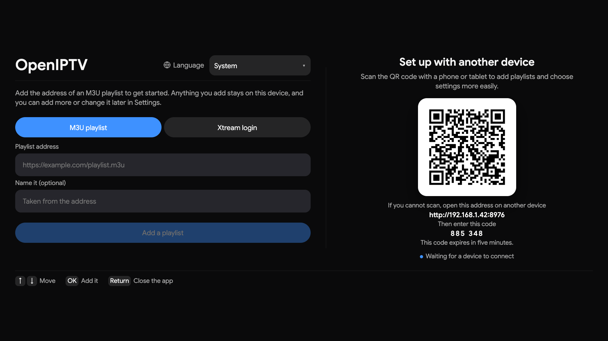
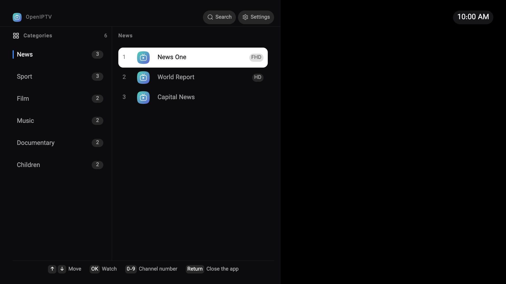
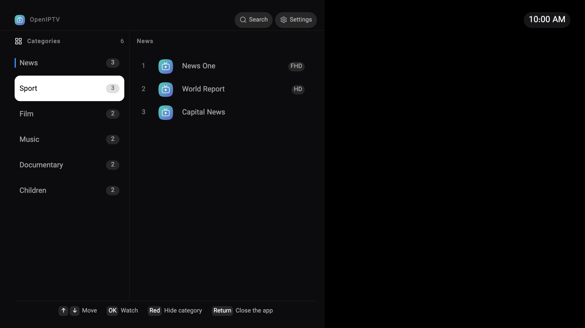
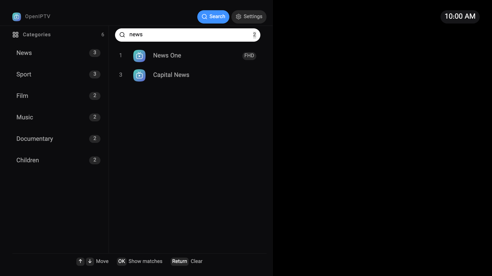
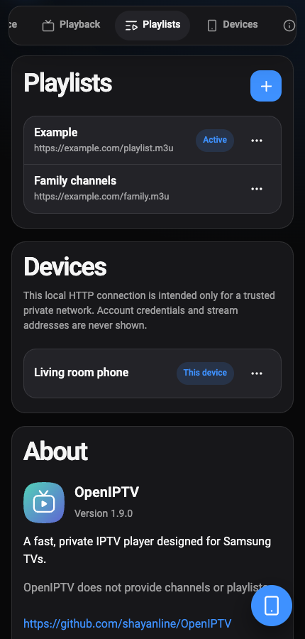
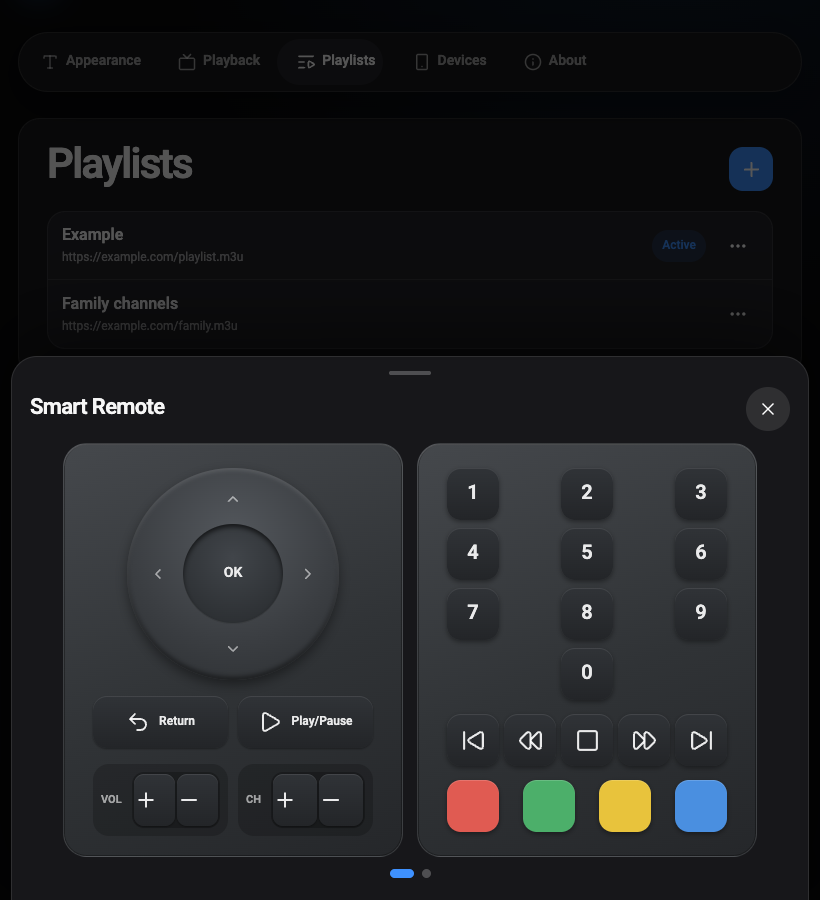
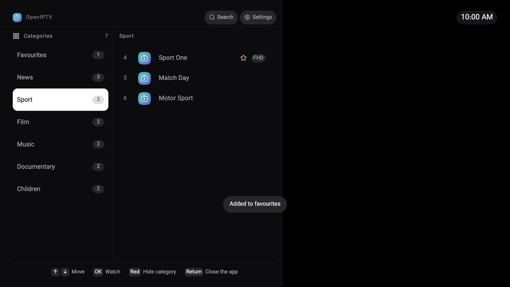
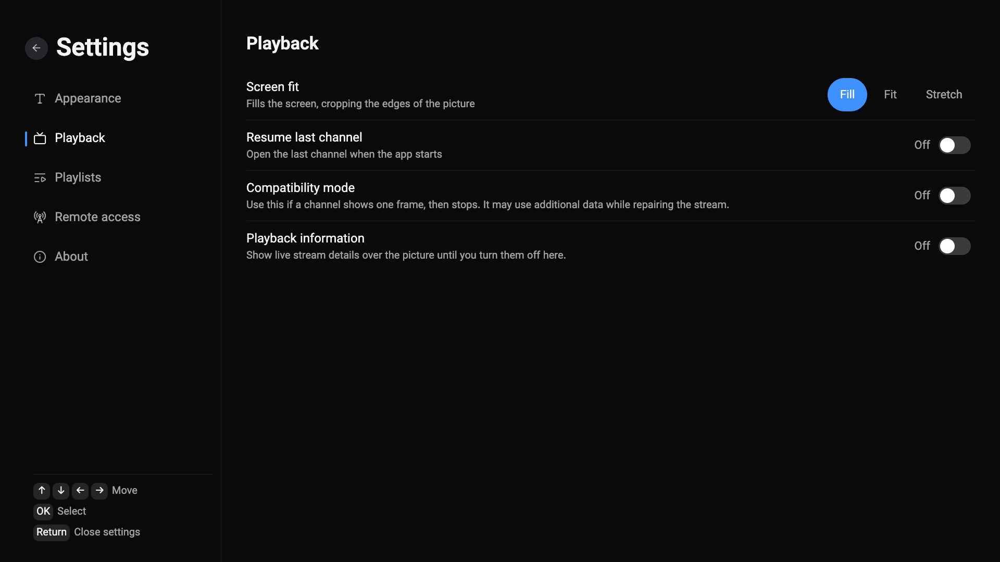
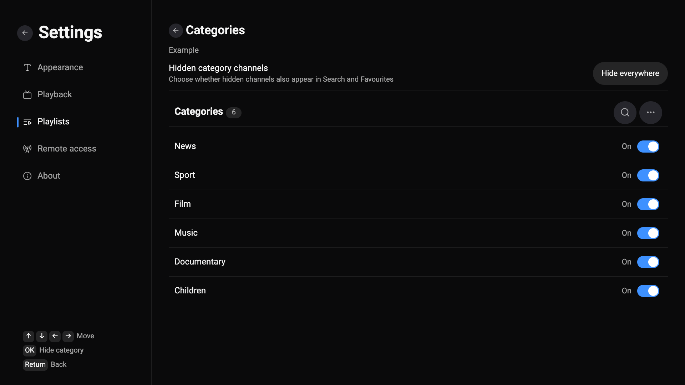
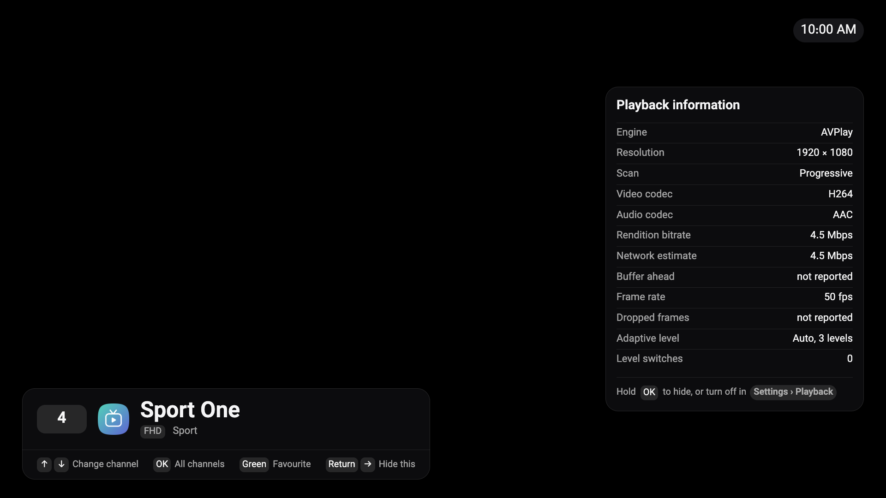

#  Zappa TV

**Zappa TV** is a high-performance, private IPTV & VOD client engineered natively for **Samsung Tizen Smart TVs**. Designed specifically as the premier television interface for **IPTV Manager** and compatible with standard Xtream Codes and M3U playlists, Zappa TV delivers a unified, high-framerate frosted-glass experience built for TV remote navigation.

🔒 **Your privacy stays yours**: All playlists, credentials, preferences, and favourites remain strictly on your television. Zappa TV includes zero user tracking, zero telemetry, zero analytics, zero advertising, and requires no external accounts.

> [!IMPORTANT]
> **Zappa TV is a media player application and does not provide channels, playlists, or streaming content.** The project is not affiliated with any broadcaster, streaming service, or playlist provider. Ensure you have the legal right to access any stream or playlist you configure.

---

## 📸 Interface Showcase

| 🚀 Start Page & Hero Hub | 📺 Adaptive Channel Tile Grid |
| :---: | :---: |
|  |  |
| *Hero Hub with live resume & fast section entry* | *4–6 column tile grid with live EPG progress & group ribbon* |

| 📋 Translucent Channel & 7-Day EPG | 🔍 Fast Channel & Content Search |
| :---: | :---: |
|  |  |
| *Overlay keeping live video visible with catch-up replay ▶* | *Instant real-time search across live channels and categories* |

| 📱 Phone QR Pairing & Setup | 🕹️ WebAssembly Smart Remote |
| :---: | :---: |
|  |  |
| *Scan QR on TV for 5-second playlist setup from your phone* | *Full virtual remote with directional, number & color buttons* |

<b>👀 View more television screens (Settings, Favourites, Categories)</b>

 

| ⭐ Favourites Management | ⚙️ Playback & Audio Settings |
| :---: | :---: |
|  |  |
| *One-touch green button toggle for favourite channels* | *Hardware buffer, aspect ratio, and audio preferences* |

| 🗂️ Playlist Category Visibility | ℹ️ Live Stream Technical Diagnostics |
| :---: | :---: |
|  |  |
| *Conceal or reorder unwanted categories per playlist* | *Real-time bitrate, codec, resolution, and buffer statistics* |

---

## ✨ Features & Capabilities

### 📺 Live TV & 7-Day Catch-Up Guide
- **Adaptive Channel Tile Grid**: 4–6 column windowed grid scaled dynamically to your television screen size, featuring real-time EPG broadcast progress bars, channel number badges, channel logos, and signature parallelogram category ribbon.
- **Translucent Side-by-Side EPG Panel**: 3-pane overlay preserving broadcast picture on the right third of the screen. Browse categories, channels, and full 7-day schedules with catch-up badges (`▶ replay`).
- **Batch EPG Integration**: Fast single-query guide population (`/api/epg/batch`) preventing sluggish network bottlenecks.
- **Instant Channel Zapping**: Debounced 450ms tuning settle with a 12-second playhead stall watchdog and automatic reconnect retry (`4s / 8s / 15s`).

### 🎬 Dual VOD Browsing & Episode Management
- **Poster Grid & Fast List Duality**: Seamlessly switch between rich 6-column movie/series poster grids and lightweight high-density linear lists.
- **Series Hub & Season Navigation**: Comprehensive season pills, episode lists, individual progress indicators, and metadata cards.
- **Up Next Autoplay with Timing Safety Margin**: Calibrated episode countdown overlay triggered at `setting + 1s` before episode completion, counting down smoothly to leave exactly 1s remaining to transition streams cleanly across seasons.
- **Smart Previous Transport Logic**: Pressing Previous when playtime exceeds 60 seconds restarts the current movie/episode from `00:00`; pressing within the first 60 seconds navigates to the prior episode.
- **Bare-Fullscreen Progressive Seek**: Directional `Left` and `Right` stepping (`10s` $\to$ `30s` $\to$ `1m` $\to$ `5m` $\to$ `10m`) at bare picture playback updates only a transient preview badge without raising the OSD banner or jumping the timeline.

### ⚡ Samsung AVPlay Hardware Engine
- **Low-Latency Streaming Buffers**: Tuned 1000ms live buffers (`PLAYER_BUFFER_FOR_PLAY = 1s`) optimized for IPTV Manager's Rust MPEG-TS proxy (port 8001), paired with 5000ms VOD buffers.
- **Hardware Multi-Audio & Native Subtitles**: Instant track enumeration and hardware switching via `webapis.avplay` for AAC, AC3, E-AC3, DTS audio, and DVB, Teletext, and CEA-708 subtitle tracks.
- **Automatic 4:3 SD Aspect Ratio Scaling**: Automatic `NARROW_ASPECT = 1.6` detection that scales legacy standard definition broadcasts to full screen while preserving 16:9 HD/UHD presentation.

### 💾 Two-Tier Storage Architecture
- **Instant Boot Storage**: Synchronous `localStorage` for zero-delay boot straight into the last-watched channel and user preferences.
- **Dedicated 200MB Persistent VOD Storage (`zappa-vod`)**: Isolated IndexedDB database for movies, series, and episode metadata, completely safeguarding live channel logos from eviction.
- **24MB Live TV Storage**: Refetchable LRU cache for channels, logos, and EPG schedules.
- **Zero UI Stutter**: All logo processing and catalog persistence run during idle frame budgets via `requestIdleCallback` to maintain 60fps remote navigation.

### 📱 Phone QR Setup & WebAssembly SmartRemote
- **Zero-Typing Onboarding**: Display a QR code on your TV screen to configure server URLs and tokens directly from your phone in 5 seconds.
- **Virtual SmartRemote**: WebAssembly HTTP management server running on the TV provides a responsive browser-based remote control with directional pad, numeric keypad, volume/channel rockers, and color buttons.

### 🔒 Security, Parental Controls & Screensaver
- **Parental PIN Lock**: 4-digit security PIN toggle with persistent lock state across TV sessions to restrict adult or protected categories.
- **Configurable Screensaver**: Idle timeout options (`1m`, `3m`, `5m`, `10m`) to safeguard OLED and QLED panels against burn-in.
- **Multilingual UI**: Native translations for English, Swedish, and Arabic, featuring complete Right-to-Left (RTL) layout switching.

---

## 📥 Installation on Samsung Smart TVs

The verified baseline is **v1.0 on Samsung Smart TVs running Tizen 5.0+** (tested on Samsung `QE55Q70RATXXC`, firmware `T-MSMDEUC-1510.0`). Tizen 5.0 and 5.5 are priority targets; 3.0 and 4.0 are experimental.

Zappa TV packages are delivered unsigned for **Apps2Samsung automatic signing**; no developer certificates, Tizen Studio signing profiles, or passwords are required.

### 1. Prepare the Television
1. Open the **Apps** store on your Samsung TV.
2. On your TV remote, press sequence **`1` `2` `3` `4` `5`**.
3. In the Developer Mode popup, turn the switch **ON** and enter your computer's local IP address (e.g. `192.168.1.50`).
4. **Restart the TV**: Hold the remote Power button until the Samsung logo appears, or unplug the TV power cord for 15 seconds to fully open the developer port.

### 2. Install with Apps2Samsung
1. Download and open [**Apps2Samsung**](https://github.com/Apps2Samsung/Apps2Samsung/releases/latest) on your computer (Windows, macOS, Linux, or Android).
2. Connect to your television's IP address.
3. Download the versioned package for your Tizen version from [**Zappa TV Releases**](../../releases):
   - **Tizen 5.0**: `zappa-1.0-tizen5.wgt`
   - **Tizen 5.5+**: `zappa-1.0.wgt`
   - *(Optional experimental targets)*: `zappa-1.0-tizen4.wgt` or `zappa-1.0-tizen3.wgt`
4. Under Apps2Samsung Advanced options, enable **Custom WGT**, select the downloaded `.wgt` file, and click **Install**.
5. Launch **Zappa TV** from your TV's application rail.

> [!TIP]
> **Updating**: Install newer versions through the exact same Apps2Samsung workflow without clearing app data. Your playlists, favourites, progress, and settings are retained.

---

## 🔌 Playlist & IPTV Manager Setup

Zappa TV supports three flexible connection modes:

| Connection Mode | What to Enter | Best For |
| :--- | :--- | :--- |
| **IPTV Manager Single-Token** | **Server URL** (e.g. `http://192.168.1.100:8000`) **Client Token** (`x-zappa-token`) | **Recommended**: Direct integration with IPTV Manager's Rust proxy (`:8001`) and single-query batch EPG (`/api/epg/batch`). |
| **Xtream Codes API** | **Server URL**, **Username**, **Password**, and stream output format (`ts` or `m3u8`) | Commercial or self-hosted Xtream providers with Live, VOD, Series, and Catch-up. |
| **Extended M3U** | **Playlist URL** (`http://` or `https://`) | Standard M3U/M3U8 playlists with `tvg-id`, `tvg-logo`, and group tags. |

Save multiple playlists and switch between them at any time. Each playlist maintains independent category visibility and favourites.

---

## 🎮 Unified Remote Control Guide

Zappa TV follows **The Four Laws of the TV Remote Key Model**, generalized across Live TV, VOD playback, and menu navigation:

| Key | Bare Live TV Playback | Bare VOD Playback (Movies & Episodes) | UI Menus, Grids & Settings |
| :---: | :---: | :---: | :---: |
| <kbd>↑</kbd> <kbd>↓</kbd> | Summon Playback OSD & Settings *(never changes channel)* | Summon Playback OSD & Transport Controls | Move focus vertically between rows, tiles, or fields |
| <kbd>OK</kbd> | Toggle Playback OSD Banner *(never opens channel list)* | Toggle Play / Pause & reveal OSD Banner | Select, activate, or enter highlighted item |
| <kbd>←</kbd> | Open Channel & EPG Overlay Panel | Progressive Seek Backward (`-10s` $\to$ `-10m`) | Move focus left across columns, rails, or tabs |
| <kbd>→</kbd> | Reveal Playback OSD Banner | Progressive Seek Forward (`+10s` $\to$ `+10m`) | Move focus right toward channels, schedule, or details |
| <kbd>Return</kbd> | Return to Start Page / Exit Dialog | Step back to VOD Hub *(background playback continues)* | Step back one layer in the screen stack / dismiss panel |
| <kbd>Ch+</kbd> <kbd>Ch-</kbd> | Step to Previous / Next Channel | Previous / Next Episode | Page scroll through channel lists |
| <kbd>0</kbd>–<kbd>9</kbd> | Direct channel number tuning | Direct chapter / number input | Enter PIN code or filter numbers |
| <kbd>Green</kbd> | Toggle Channel in Favourites | Toggle Favourite state | Toggle Favourite state |
| <kbd>Red</kbd> | — | Stop VOD Playback and return to Hub | Toggle category visibility (Hold: reveal hidden) |
| <kbd>Yellow</kbd> | Quick-open Settings | Quick-open Settings | Quick-open Settings |
| <kbd>Blue</kbd> | Toggle Technical Stream Info | Audio & Subtitle Track Picker | Toggle aspect ratio / filter |
| <kbd>Play</kbd> / <kbd>Pause</kbd> | Pause / Resume Live Timeshift | Pause / Resume Playback | Pause / Resume active playback |
| <kbd>Stop</kbd> | Stop Live Playback | Stop VOD and return to Hub | Dismiss overlay |

---

## ❓ Frequently Asked Questions & Troubleshooting

<b>1. Apps2Samsung cannot discover or connect to the TV</b>

 
Verify that your television and computer are on the exact same local Wi-Fi / Ethernet subnet (avoid guest networks with client isolation). Recheck Developer Mode on the TV (Apps $\to$ <code>1 2 3 4 5</code>) and ensure your computer's IP address is saved. Finally, unplug the television from the wall power for 15 seconds to restart the Tizen Developer daemon.

<b>2. How do I switch multi-audio languages or DVB subtitles?</b>

 
During playback, press <kbd>Blue</kbd> on your remote or press <kbd>Down</kbd> / <kbd>OK</kbd> to summon the playback OSD banner. Navigate to Row 2 to choose from detected hardware audio streams (e.g. English AC3, Swedish AAC) and subtitle tracks (DVB, Teletext, CEA-708, or Off).

<b>3. An Xtream live stream stalls or fails to load</b>

 
Open <b>Settings</b> $\to$ <b>Playlists</b> $\to$ Edit Playlist, and switch stream format between <code>MPEG-TS (ts)</code> and <code>HLS (m3u8)</code>. When connected to IPTV Manager, ensure the proxy service is accessible on Port 8001. Zappa TV's built-in watchdog automatically retries dropped streams at 4s, 8s, and 15s.

<b>4. How do I reset or change my Parental Control PIN?</b>

 
The Parental Control PIN is configured under <b>Settings</b> $\to$ <b>Parental Control</b>. If you ever forget your PIN, you can reset it by clearing application preferences through the local WebAssembly Smart Remote on your paired phone or reinstalling the widget via Apps2Samsung.

<b>5. Channel logos are loading slowly</b>

 
Zappa TV caches channel logos in a local IndexedDB storage budget on the television and decodes them during idle frame slices. Initial population across thousands of channels will settle automatically after first load without dropping D-pad navigation below 60fps.

---

## 📄 License & Notices

Zappa TV is licensed under the [**MIT License**](LICENSE).  
Third-party component licenses and runtime notices are detailed in [**THIRD-PARTY-NOTICES.md**](public/THIRD-PARTY-NOTICES.md).
